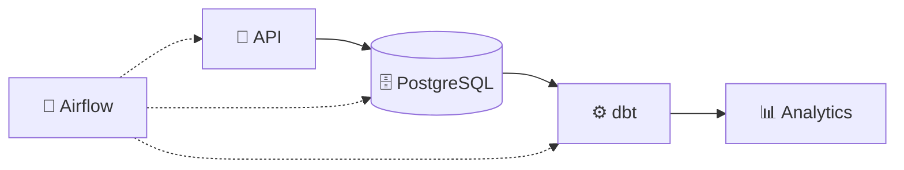

<h1 align="center">¡Hola! 👋 Soy Juan David Yanayaco Saenz</h1>

  

  
  
  

---

## 🚀 Sobre mí

- 🎓 Ingeniería en Ciencia de Datos — **Corporación Universitaria Iberoamericana**
- 🔭 Construyo **pipelines de datos end-to-end** con Airflow, dbt, PostgreSQL y Docker
- 📊 Formación en análisis de datos con Python (programa **ONE / Alura Latam**)
- 🌱 Profundizando en **modelado dimensional, orquestación y cloud (GCP/AWS)**
- 🎯 Objetivo: rol de **Data Engineer** aportando datos confiables y automatizados

## 🛠️ Stack Tecnológico

| Área | Herramientas |
|---|---|
| **Lenguajes** |    |
| **Orquestación** |  |
| **Transformación** |   |
| **Almacenamiento** |    |
| **Infraestructura** |    |
| **Análisis** |    |

## 📌 Proyecto Destacado

**Pipeline ELT end-to-end** para análisis de fuga de clientes: ingesta desde API → PostgreSQL → transformación con dbt (staging → marts + tests de calidad) → orquestación con Airflow. Todo el entorno se levanta con un solo `docker-compose up`.

## 📈 Estadísticas

  
  

  

---

<i>💬 Abierto a oportunidades y colaboraciones en ingeniería de datos</i>

